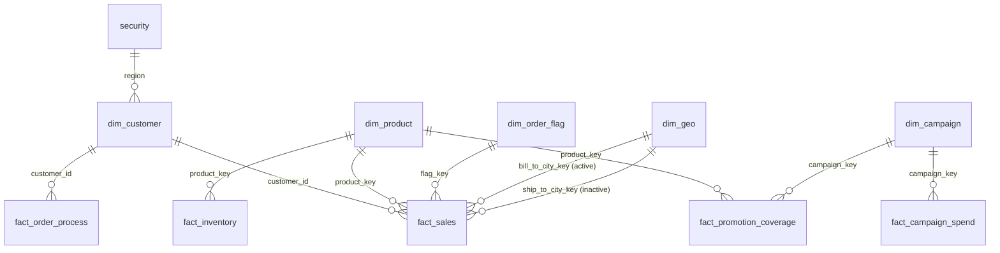

# Enterprise Sales Data Model in Power BI

A star-schema data model built in Power BI Desktop that unifies sales, order fulfilment, inventory, marketing and targets into one governed model, with region-based security and a KPI layer ready for reporting.


-success)

---

## Project Overview

Raw business data is usually scattered across separate tables: sales lines, shipping records, stock levels, campaign spend. This project brings them together into a clean, query-efficient **constellation (multi-fact star) schema** so one set of shared dimensions can answer questions across sales, operations and marketing.

**Goals**
- Design a scalable model with clear fact and dimension separation
- Enforce correct relationship cardinality and filter direction
- Handle a role-playing dimension (bill-to vs ship-to city)
- Control data access by region using a security mapping table
- Centralise KPIs in a dedicated measures table

---

## Data Model




### Tables

| Type | Table | Grain / Purpose |
|------|-------|-----------------|
| Fact | `fact_sales` | One row per order line (quantity, unit price, unit cost, discount, line total) |
| Fact | `fact_order_process` | One row per order, with order, ship, delivery, invoice and pay dates plus `order_to_pay` days |
| Fact | `fact_inventory` | Units on hand by product and date |
| Fact | `fact_campaign_spend` | Impressions, clicks and spend by campaign and date |
| Fact | `fact_promotion_coverage` | Bridge between campaigns and the products they cover |
| Fact | `fact_sales_target` | Target revenue by date |
| Dimension | `dim_customer` | Customer, segment, account manager, payment terms, credit limit, region |
| Dimension | `dim_product` | Product, brand, category, subcategory, supplier, price |
| Dimension | `dim_geo` | City and region |
| Dimension | `dim_order_flag` | Order channel, status and priority |
| Dimension | `dim_campaign` | Campaign name, channel, dates, budget |
| Dimension | `dim_date` | Calendar table (`CALENDARAUTO()`) |
| Security | `security` | Maps user email to region for row-level security |
| Measures | `_measures` | Dedicated table holding all DAX measures |

---

## Key Design Decisions

- **Star / constellation schema:** facts hold numbers and keys, dimensions hold descriptive attributes. Several fact tables share the same dimensions (e.g. `dim_product`, `dim_customer`, `dim_campaign`).
- **Many-to-one, single-direction relationships** throughout, which keeps filter propagation predictable and avoids ambiguity.
- **Role-playing dimension:** `dim_geo` is used twice by `fact_sales`. The bill-to relationship is active; the ship-to relationship is inactive and can be activated in DAX with `USERELATIONSHIP()`.
- **Bridge table:** `fact_promotion_coverage` resolves the many-to-many relationship between campaigns and products.
- **Security layer:** the `security` table (user email → region) connects to `dim_customer[region]`, enabling region-level row security.
- **Measures table:** `_measures` keeps KPIs in one place, separate from the data tables.

---

## DAX Measures

```DAX
total_sales            = SUM ( fact_sales[line_total] )
total_orders           = DISTINCTCOUNT ( fact_sales[order_id] )
total_active_customers = DISTINCTCOUNT ( fact_sales[customer_id] )
avg_order_to_pay       = AVERAGE ( fact_order_process[order_to_pay] )
```

| KPI | What it tells you |
|-----|-------------------|
| Total Sales | Overall revenue from order lines |
| Total Orders | Number of distinct orders |
| Total Active Customers | Customers who actually purchased |
| Avg Order-to-Pay | Average days from order to payment (cash-cycle indicator) |

---

## Report

A one-page report with KPI cards for the four measures above, built directly on the model.

---

## Tech Stack

- Power BI Desktop (modeling, relationships, security)
- DAX (measures, calculated tables)
- Power Query (data shaping)

---

## Repository Structure

```
├── Project_Data_Modeling.pbix   # Power BI file
├── README.md
└── docs/
    └── model-view.png           # Screenshot of the model diagram
```

## How to Open

1. Install [Power BI Desktop](https://powerbi.microsoft.com/desktop/)
2. Download `Project_Data_Modeling.pbix`
3. Open it and go to **Model view** to explore tables and relationships

---

## What I Learned

- Designing a multi-fact star schema and choosing the right grain for each table
- Why cardinality and filter direction matter for correct numbers
- Handling role-playing dimensions with inactive relationships
- Structuring security and KPI layers so a model is reusable, not just a one-off report

## Possible Next Steps

- Connect `dim_date` to the fact tables for time-intelligence measures (YTD, MoM, YoY)
- Add target-vs-actual and gross margin measures
- Build multi-page dashboards for sales, operations and marketing

---

## Author

**Kasim**
B.Tech CSE (2027) | Aspiring Data Analyst | SQL · Excel · Python · Power BI

[LinkedIn](https://www.linkedin.com/in/kasim-abbasi-889b61308) · [GitHub](https://github.com/kasim-01)

